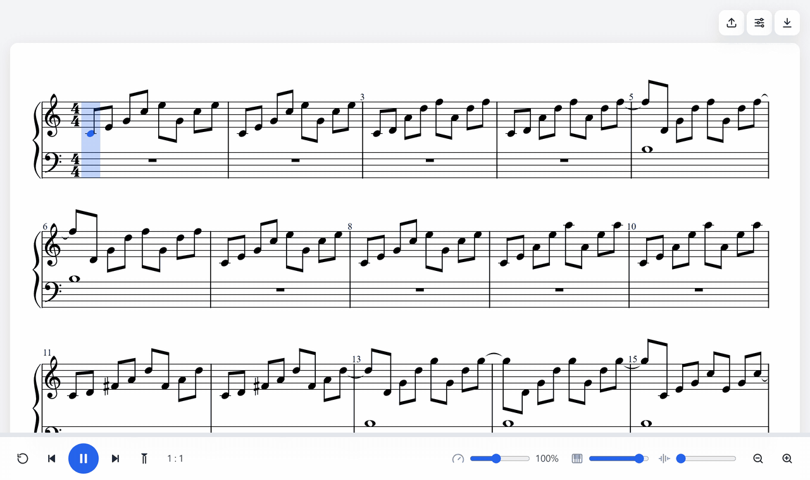

# AI Sheet

Turn music into sheet.



## Run

```bash
docker run -p 127.0.0.1:8765:8765 ghcr.io/dennis96292/ai-sheet
```


Open http://localhost:8765 and drop in a song.

## Build

```bash
docker build -t ai-sheet .
```

## Develop

```bash
npm install
python server/setup.py
npm run server
npm run dev
```

## License

MIT. Built on [Transkun](https://github.com/Yujia-Yan/Transkun) and [PM2S](https://github.com/cheriell/PM2S). See [notices](THIRD_PARTY_NOTICES.md).
